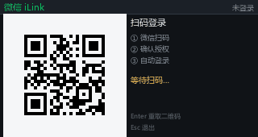
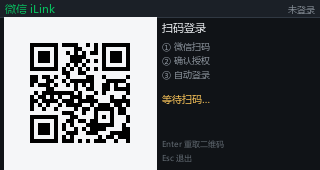
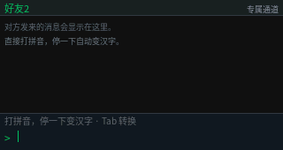
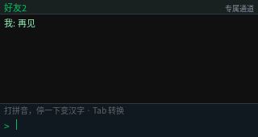

# wechat-zero · 在 Cardputer Zero 上用微信

把 [gywan94/cardputer-wechat](https://github.com/gywan94/cardputer-wechat) 的微信 iLink
玩法搬到 **M5Stack Cardputer Zero**（aarch64 Debian、320×170 屏、46 键键盘）上，
并补上原项目没有的三件事：

- **中文输入**：离线拼音输入法（7.7 万词条，本地组句，不联网、不耗 token）
- **多好友**：每位好友独立会话、独立通道、未读计数、备注名
- **好友扫码添加**：设备生成邀请二维码，好友微信扫码确认后，**你可以主动给他发消息**

原项目是 ESP32-S3 + Arduino + LVGL 的单文件实现，且只记住"最后一个发消息的人"。
这里是按同一套 iLink 协议重写的 Linux/Python 版本：不移植 Arduino 代码，只移植协议和交互。



| 扫码登录 | 邀请好友扫码 | 专属通道里主动发消息 |
|---|---|---|
|  |  |  |

---

## 1. 两种二维码，分别解决什么

微信 iLink 的扫码有**两种语义**，这是理解本项目的关键：

| 二维码 | 谁扫 | 结果 |
|---|---|---|
| **登录码**（启动时显示） | 你本人 | 把这台设备的 bot 绑定到你的微信；你给 bot 发消息，设备才能回复 |
| **邀请码**（列表里按 `F2`） | 好友 | 官方"连接此 OpenClaw 到他的微信"流程：好友成为这个 bot 的 owner，设备**可以直接给他发消息**，不需要他先开口 |

所以"添加好友"不是输入微信号，也不是加通讯录：

1. 列表按 `F2` → 屏幕出现邀请二维码
2. 好友用微信扫码 → 手机上确认授权（微信侧可能要求实名确认）
3. 设备自动建好这个好友的"专属通道"，直接进入聊天，**马上就能发消息**

> 每个好友对应一个独立的 bot 通道。好友那边会看到一个机器人联系人；这是微信 iLink
> 的绑定机制，不是普通的"加好友"。官方 CLI 在绑定时也会问
> "连接此 OpenClaw 到你的微信？Y/其他"，选"其他"就是给好友扫的这条路径。

---

## 2. 它做了什么

| 能力 | 说明 |
|---|---|
| 扫码登录 | 屏幕上直接画二维码，微信扫码确认后自动拿到 `bot_token`、`baseurl`、`ilink_user_id` |
| 邀请好友 | `F2` 现场申请新的 bot 二维码；好友扫码确认后自动建"专属通道" |
| 主动发消息 | 对邀请通道的好友，不需要 `context_token` 也能发（他是该 bot 的 owner） |
| 收消息 | 每个通道各自长轮询 `getupdates`（45s），断线指数退避重连 |
| 发消息 | 按 UTF-8 安全分片（≤1000 字 / ≤2000 字节）调用 `sendmessage` |
| 多好友 | 每个人一条独立会话；列表按最近消息排序；未读红点；备注名 |
| 中文输入 | 打拼音后按 `Tab` 转汉字；`1/2/3` 选词；`0` 翻页；不再停顿自动转换 |
| 持久化 | 多通道 token、好友、聊天记录、未读、游标全部落盘，重启接着用 |
| 掉线重连 | 每个通道独立退避；主号 401 自动回登录页，邀请通道失效会提示重新邀请 |

**做不到的**（iLink 协议限制）：

- 对**没有邀请通道**、也**没给主 bot 发过消息**的人，不能主动发起会话（没有 `context_token`）
- 好友扫码必须由好友本人在手机上确认；设备不能替他授权
- 只支持文字；图片/语音/文件不解析
- 每个 bot 通道有服务端频率限制（约 7 条 / 5 分钟）

---

## 3. 安装

> 下面的 GitHub 地址用的是 `release.json` 里的默认 owner `gywan94`。
> 如果你发布到自己的账号，先改 `release.json` 的 `github_owner` / `github_repo`，
> 再运行 `python tools/build_release.py`，所有下载地址和 AppStore 清单会自动跟着变。

### 3.1 一行安装（推荐）

Cardputer Zero 联网后执行：

```bash
curl -fsSL https://raw.githubusercontent.com/gywan94/wechat-zero/main/get.sh | sh
```

脚本会下载最新 `.deb`、`apt install` 并重启 APPLaunch。也可以指定版本：

```bash
VERSION=1.1.0 sh get.sh
```

### 3.2 下载 .deb 安装

从 [GitHub Releases](https://github.com/gywan94/wechat-zero/releases) 下载：

```bash
sudo apt install ./wechat-zero_1.1.0_all.deb
systemctl --user restart APPLaunch
```

这是一个纯 Python 包，`Architecture: all`；依赖 `python3-pil`、`python3-evdev`，
推荐中文字体（`fonts-noto-cjk` 或 `fonts-wqy-zenhei`）。AppStore 上架的也是同一个 `.deb`。

### 3.3 开发 / 手动 tar 包

```powershell
py wechat-zero\tools\package.py          # dist/wechat-zero-1.1.0.tar.gz
```

```bash
tar xzf wechat-zero-1.1.0.tar.gz
cd wechat-zero-1.1.0
sudo ./install.sh --with-deps
```

装完在 **APPLaunch** 里会出现「微信」；命令行也可以：

```bash
wechat-zero              # 启动
wechat-zero --selftest   # 检查帧缓冲 / 键盘 / 字体 / 输入法 / 通道状态
```

## 4. 用法

### 4.1 第一次登录（你本人扫）

1. 设备联网，打开「微信」
2. 屏幕出现登录二维码，右侧提示"等待扫码…"
3. 你本人用微信扫 → 手机上确认 → 自动进入好友列表
4. 二维码过期会自动重取，也可以按 `Enter` 立即重取

> 登录凭证保存在 `~/.config/wechat-zero/state.json`，权限 0600。

### 4.2 邀请好友（好友扫）

1. 好友列表或聊天里按 `F2`
2. 屏幕出现**邀请二维码**，文案是"好友扫码"
3. 让好友用他的微信扫 → 手机上确认授权
4. 设备自动创建"专属通道"并进入聊天，标题右侧显示 **专属通道**
5. 直接输入、发送即可——不用等好友先说话

好友扫码后，他的微信里会出现一个机器人联系人；之后他也可以主动给这个机器人发消息，
设备会在同一个会话里收到。

### 4.3 按键

| 场景 | 按键 |
|---|---|
| 列表上下移动 | `↑` `↓` |
| 打开会话 | `Enter` |
| **邀请好友扫码** | `F2`（列表或聊天里都可以） |
| 备注名（支持中文） | `F3` |
| 删除好友（含记录） | `Del` 或 `F8` → `Enter` 确认 |
| 重新扫码登录 | `F5` → `Enter` 确认（清所有通道 token，保留记录） |
| 帮助 | `F1` |
| 聊天里翻看历史 | `↑` `↓` |
| 发送 | `Enter` |
| 返回列表 | `Esc` |
| 退出应用 | 列表里按 `Esc` |
| 邀请页取消 / 重取二维码 | `Esc` / `Enter` |

**好友名**：iLink 只给用户 ID，不提供昵称。邀请成功时默认叫「好友2」「好友3」，
按 `F3` 起中文备注名即可。

### 4.4 中文输入

| 操作 | 说明 |
|---|---|
| 打拼音 | `jintiantianqi`，**不会**自己变汉字 |
| `Tab` | 把末尾拼音转成汉字（候选条出现） |
| `Enter` | 发送；末尾还是拼音时先转换再发 |
| `1` `2` `3` | 从候选条里选第 1/2/3 个 |
| `0` | 候选翻页 |
| `Esc` | 取消转换，退回拼音 |

输入法完全离线：`assets/ime.db` 是 jieba 词频 + pypinyin 编译的 SQLite，DP 组句偏向长词。
在 4×A53 上单次转换几毫秒。停顿不再触发转换，避免打完英文/缩写被误转。

---

## 5. 架构

```
┌──────────────── Cardputer Zero ────────────────┐
│ wechat.py                                      │
│  ├─ wz/app.py    状态机：登录 → 邀请 → 列表/聊天│
│  ├─ wz/ilink.py  iLink 协议（QR/长轮询/发送）  │
│  ├─ wz/model.py  多通道 + 多好友 + JSON 落盘   │
│  ├─ wz/ui.py     320×170 Pillow 绘制           │
│  ├─ wz/ime.py    离线拼音（SQLite DP）         │
│  ├─ wz/keys.py   evdev 键盘映射                │
│  └─ wz/fb.py     /dev/fb0 RGB565 输出          │
└───────────────────────┬────────────────────────┘
                        │ HTTPS（每通道一条长轮询）
                        ▼
        ilinkai.weixin.qq.com  /ilink/bot/*
```

### 协议（与上游一致）

| 接口 | 作用 |
|---|---|
| `GET /ilink/bot/get_bot_qrcode?bot_type=3` | 取二维码；登录和邀请都用它各申请一个新 bot |
| `GET /ilink/bot/get_qrcode_status?qrcode=…` | `wait` / `confirmed` / `expired`；成功后返回 `bot_token`、`ilink_bot_id`、`ilink_user_id`、`baseurl` |
| `POST /ilink/bot/getupdates` | 长轮询，body `{get_updates_buf, base_info:{channel_version:"1.0.2"}}` |
| `POST /ilink/bot/sendmessage` | 发文字；回复普通好友要带 `context_token`，邀请通道的 owner 可以不带 |

请求头：`AuthorizationType: ilink_bot_token`、`Authorization: Bearer <token>`、
`X-WECHAT-UIN: base64(4 字节随机)`（一次安装内固定）。
传输层用 `http.client` 而不是 `urllib`，因为 `urllib` 会把头名改成 `Authorizationtype`，
而上游固件发的是精确大小写；这里保持逐字节一致。

`ilink_user_id`（扫码人）非常关键：它就是该通道的 owner。`sendmessage` 的
`to_user_id` 填它、`context_token` 留空，就是"主动给好友发第一条消息"。

### 数据模型（state.json v2）

```json
{
  "version": 2,
  "primary": "main",
  "accounts": [
    {"id": "main", "token": "…", "host": "ilinkai.weixin.qq.com",
     "scheme": "https", "cursor": "…", "owner": "wxid_me",
     "name": "我", "kind": "main"},
    {"id": "bot-2", "token": "…", "owner": "wxid_friend",
     "name": "好友2", "kind": "invite", "cursor": "…"}
  ],
  "friends": [
    {"uid": "wxid_friend", "name": "好友2", "account": "bot-2",
     "ctx": "", "unread": 0, "last_ts": 1700000000.0,
     "messages": [{"who": "me", "text": "你好", "ts": 1700000000.0}]}
  ]
}
```

- 一个 account = 一个 bot token = 一条独立长轮询
- `friend.account` 决定发送走哪个 token
- `ctx` 每条入站消息都会刷新；邀请通道的 owner 即使 `ctx` 为空也能发
- 每好友最多 120 条消息；去重键 `uid#message_id`
- 写入用临时文件 + `os.replace`，断电不会写坏；文件权限 0600

---

## 6. 开发与测试

```powershell
# 全部测试（协议 / 存储 / 输入法 / UI / 打包 / 多通道邀请全流程）
py -m unittest discover -s wechat-zero\tests -p "test_*.py"

# 渲染每个界面到 PNG（不需要设备）
py wechat-zero\wechat.py --preview wechat-zero\preview

# 用本地假 iLink 服务器录一段演示 GIF
py wechat-zero\tools\demo.py
```

`tests/fake_server.py` 实现了 iLink 端点，并支持**多个 bot**：登录一个、邀请一个。
端到端测试会真的跑：

```
主号扫码 → 确认 → 好友来消息 → 拼音转汉字 → 带 context 回复
      → F2 邀请 → 好友扫码确认 → 建专属通道 → 不带 context 主动发送
```

目录：

```
wechat-zero/
├── wechat.py            入口 / 自检 / 预览
├── wz/                  应用（app, ilink, model, ui, ime, keys, fb, sim）
├── vendor/qrcodegen.py  纯 Python 二维码（MIT，Project Nayuki）
├── assets/ime.db        拼音词典（3.3 MB）
├── assets/icon-128.png  APPLaunch 图标
├── bin/wechat-zero      启动脚本
├── packaging/*.desktop  APPLaunch 入口
├── install.sh           设备端手动安装
├── app-builder.json     AppStore 清单（构建时生成）
├── release.json         发布配置（GitHub/作者/share_code）
├── get.sh               一行安装脚本
├── RELEASE.md           GitHub + AppStore 发布指南
├── tools/               deploy / package / demo / 真机测试
└── tests/               单元 + 端到端测试
```

---

## 7. 排错

| 现象 | 处理 |
|---|---|
| 启动黑屏后退出 | 跑 `wechat-zero --selftest` 看帧缓冲/字体；无中文字体会显示方块而不是崩溃 |
| `python3-evdev` 缺失 | `sudo apt install python3-evdev`，或 `sudo ./install.sh --with-deps` |
| 中文全是方块 | `sudo apt install fonts-wqy-zenhei`，重启应用 |
| 二维码扫不出 | 提高亮度；二维码 148px，模块 2–4px；可 `Enter` 重新取码 |
| 一直"等待扫码…" | 设备时间不准会导致 HTTPS 失败；`timedatectl` 校时 |
| 登录后"离线" | 检查 DNS/防火墙；每个通道独立退避，恢复后自动重连 |
| 邀请页一直等待 | 好友需要扫码并在手机上确认；部分账号还会要求实名确认 |
| 好友扫了但没连上 | 微信侧可能拒绝了授权；重新 `F2` 生成新码再试 |
| 邀请后通道马上失效 | **不要用你自己的微信扫邀请码**。同一个微信不能再拥有第二条 bot 通道，请让好友用他的手机扫；应用会拦截自扫并提示 |
| 发送报"会话已过期" | 该通道 token 失效；主号会自动回登录页，好友通道需重新 `F2` 邀请 |
| 提示"通道未登录" | 该好友的邀请通道 token 失效（401）；重新 `F2` 邀请一次 |
| 发送提示"对方还没发来消息" | 这是普通（非邀请）好友，必须先给你发一条；邀请通道不会出现 |
| 发送频率限制 | 每个 bot 约 7 条 / 5 分钟，等一会儿再发 |
| 想看底层请求 | 改 `wz/ilink.py` 的 `_request` 打印 URL/状态；token 不要贴到公开地方 |

**安全**：`state.json` 里的每个 token 都等于一个微信机器人通道，权限 0600，别提交、别外发。
本项目只和微信 iLink 官方端点通信，没有第三方中转。

---

## 8. 与上游的差异

| | 上游 cardputer-wechat | 本项目 |
|---|---|---|
| 平台 | ESP32-S3 / Arduino / LVGL | Cardputer Zero / Debian / Python + Pillow |
| 好友 | 只记最后一个发送者 | 多好友独立会话、未读、备注 |
| 添加好友 | 无 | 设备生成邀请二维码，好友扫码后可直接发消息 |
| 通道 | 单 token | 多 bot token，每好友一个专属通道 |
| 中文 | 无输入法 | 离线拼音输入法 + 候选条 |
| 二维码 | LVGL 绘制 | 纯 Python QR 编码，148px 屏内绘制 |
| 会话 | 内存 | JSON 持久化（原子写、0600） |
| 键盘 | M5 Cardputer 矩阵 | evdev（复用本仓库已验证的映射） |

上游是 MIT 许可；本项目的协议实现参考了它的 `WeChatILink.cpp`，同样以 MIT 发布。
二维码编码器来自 [Project Nayuki](https://www.nayuki.io/page/qr-code-generator-library)（MIT）。

---

## 9. 实测记录

### 主机端（2026-11-18）

- `48` 个单元/端到端测试全部通过：协议、多通道存储、输入法、UI、打包、
  「登录 → 邀请 → 主动发送」全流程
- UI：所有界面 320×170 渲染、二维码像素、RGB565 打包均有断言

### 设备端（apead@192.168.50.106，Debian 13 / aarch64 / 320×170 / 352MB）

- `wechat-zero --selftest`：`/dev/fb_lcd 320x170 16bpp`、3 个输入设备、
  `NotoSansCJK-Regular.ttc`、`ime.db`、二维码编码器全部 OK
- **真实 iLink**：设备直接请求 `ilinkai.weixin.qq.com`，成功取到登录二维码并显示
- **多通道邀请（真实硬件 + 假 iLink 服务器 + `/dev/uinput` 注键）**：
  登录 → 两个好友来消息 → `F2` 出邀请二维码 → 模拟好友确认 → 建 bot-2 专属通道
  → 不带 `context_token` 发送「再见」；服务器收到
  `to_user_id=wxid_friend`、`context_token` 为空、`Authorization: Bearer tok-2`
- 同时验证了中文备注名、好友切换、未读清零、401 后主号回登录页/邀请通道失效提示

设备实拍（假 iLink 数据，真实屏幕/键盘/输入法）：

| 邀请二维码 | 专属通道 | 主动发送成功 |
|---|---|---|
|  |  |  |

复现方法见 [tools/DEVICE-TEST.md](tools/DEVICE-TEST.md)。
